# Reservas que não se concretizam: MVP de pipeline de dados em nuvem para apoio à decisão sobre cancelamentos na hotelaria

**Autor:** Diogo
**Disciplina:** Sistemas de Suporte à Decisão — Departamento de Engenharia de Produção, Universidade de Brasília (UnB)
**Professor:** André Luiz Marques Serrano
**Plataforma:** Databricks Free Edition (Serverless, Unity Catalog, Delta Lake)

Este repositório documenta um *Minimum Viable Product* (MVP) de Sistema de Suporte à Decisão: um pipeline de dados em nuvem, da coleta à análise, que investiga cancelamentos de reservas em dois hotéis e transforma o histórico de reservas em evidência para decisões de *overbooking* e de política de depósito. O short paper com a fundamentação teórica está em [`/paper`](paper/).

## Sumário

1. [Objetivo](#1-objetivo)
2. [Dados e coleta](#2-dados-e-coleta)
3. [Arquitetura do pipeline](#3-arquitetura-do-pipeline)
4. [Modelagem e catálogo de dados](#4-modelagem-e-catálogo-de-dados)
5. [Transformação e carga (ETL)](#5-transformação-e-carga-etl)
6. [Qualidade dos dados](#6-qualidade-dos-dados)
7. [Resultados: perguntas de negócio](#7-resultados-perguntas-de-negócio)
8. [Discussão geral](#8-discussão-geral)
9. [Autoavaliação](#9-autoavaliação)
10. [Como reproduzir](#10-como-reproduzir)
11. [Estrutura do repositório](#11-estrutura-do-repositório)
12. [Referências](#12-referências)

---

## 1. Objetivo

### Problema

Hotéis operam com capacidade fixa e produto perecível: uma diária não vendida não pode ser estocada. Quando uma fração relevante das reservas é cancelada, muitas vezes perto da chegada, a capacidade bloqueada volta ao estoque tarde demais para ser revendida. As respostas gerenciais usuais, aceitar mais reservas do que a capacidade (*overbooking*) e exigir depósito não reembolsável, dependem de saber **quais reservas tendem a ser canceladas**. Hoje, sem esse conhecimento, a regra costuma ser uniforme para todos os segmentos.

### Hipótese

> O risco de cancelamento varia de forma sistemática com atributos conhecidos no momento da reserva (hotel, antecedência, canal, depósito e histórico do cliente), de modo que um pipeline de dados em nuvem pode subsidiar políticas de *overbooking* e de depósito por segmento.

### Perguntas de negócio

As perguntas foram definidas antes da escolha final da base e são mantidas íntegras, inclusive as respondidas apenas em parte (ver [Autoavaliação](#9-autoavaliação)).

| # | Pergunta | Decisão que apoia |
|---|---|---|
| **Q1** | Qual a taxa de cancelamento de cada hotel e como ela varia ao longo dos meses de chegada? | Margem de *overbooking* por hotel e temporada |
| **Q2** | Como a probabilidade de cancelamento varia com a antecedência da reserva (*lead time*)? | Margem por faixa de antecedência |
| **Q3** | Quais combinações de segmento de mercado e tipo de depósito concentram as maiores taxas de cancelamento? | Política de depósito por segmento |
| **Q4** | Qual a receita potencial associada às reservas canceladas, por hotel e por mês, e qual parcela foi cancelada com menos de sete dias de antecedência da chegada? | Dimensionar o problema financeiro |
| **Q5** | Clientes recorrentes e clientes com cancelamentos anteriores apresentam comportamento distinto, a ponto de justificar tratamento diferenciado? | Regras por perfil de cliente |

---

## 2. Dados e coleta

| Item | Descrição |
|---|---|
| Conjunto de dados | *Hotel Booking Demand* |
| Fonte | Kaggle — [jessemostipak/hotel-booking-demand](https://www.kaggle.com/datasets/jessemostipak/hotel-booking-demand) |
| Publicação original | Antonio, Almeida e Nunes (2019), *Data in Brief*, v. 22, p. 41–49 |
| Licença dos dados | CC BY 4.0 (uso e redistribuição com atribuição) |
| Conteúdo | Reservas de um resort (40.060) e de um hotel urbano (79.330) em Portugal, com chegadas entre jul/2015 e ago/2017 |
| Formato original | Um arquivo CSV (`hotel_bookings.csv`) |
| Volume | 119.390 linhas × 32 colunas, 16,1 MB |
| Data da coleta | 09/11/2026 |
| Método de coleta | Download manual no site do Kaggle e upload para um *Volume* do Unity Catalog (`/Volumes/mvp_hotel/bronze/raw/`) |

**Ética e LGPD.** A base não contém dados pessoais: hotéis, agentes e empresas aparecem apenas como códigos numéricos, e o cliente é descrito somente por país e tipo. Por isso, não foi necessário anonimizar. Embora a licença permita redistribuição, **o CSV não foi versionado** neste repositório, para manter a fonte original como referência única; ele pode ser baixado no link acima.

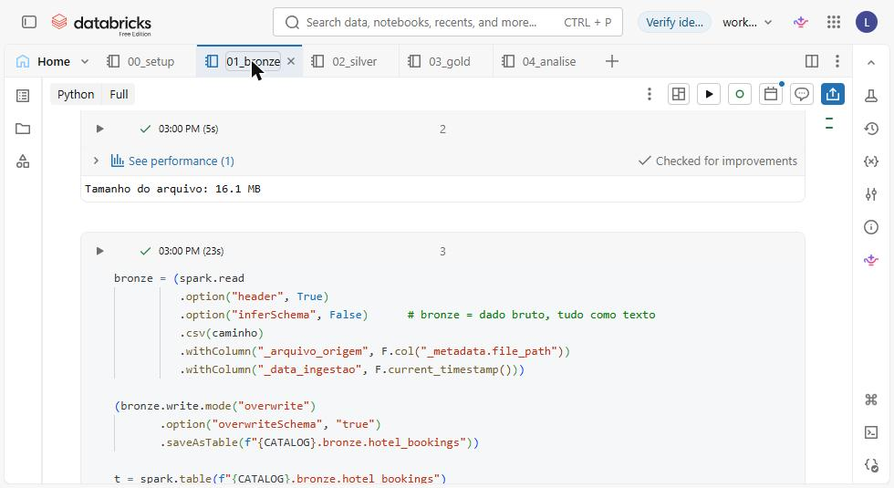

---

## 3. Arquitetura do pipeline

O pipeline segue a arquitetura *medallion* em três camadas de tabelas Delta, todas persistidas no catálogo `mvp_hotel` do Databricks:

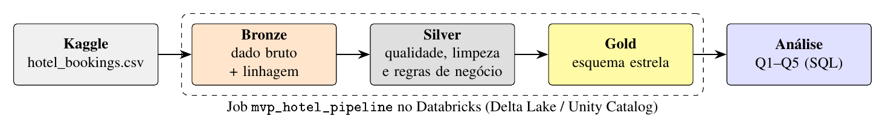

| Camada | Tabela(s) | O que contém | Notebook |
|---|---|---|---|
| Bronze | `bronze.hotel_bookings` | CSV original, todas as colunas como texto, mais `_arquivo_origem` e `_data_ingestao` (linhagem) | [`01_bronze`](notebooks/01_bronze.py) |
| Silver | `silver.reservas`, `silver.rejeitados` | Dados tipados, limpos, padronizados e com colunas derivadas; registros inválidos separados com o motivo | [`02_silver`](notebooks/02_silver.py) |
| Gold | `gold.fato_reserva` e 4 dimensões | Esquema estrela consumido pelas análises | [`03_gold`](notebooks/03_gold.py) |

As três camadas são executadas pelo **Job `mvp_hotel_pipeline`**, com três tarefas dependentes (bronze → silver → gold) em computação Serverless. A execução completa levou **1 min 33 s**:

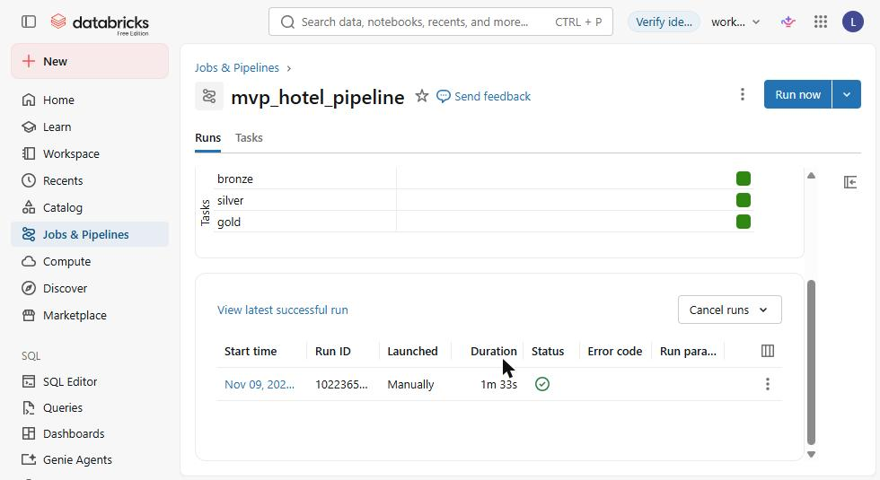

---

## 4. Modelagem e catálogo de dados

Foi adotado um **esquema estrela** (Kimball e Ross, 2013). A tabela fato tem o grão de **uma reserva**. Como a origem é um único arquivo desnormalizado, as dimensões foram derivadas por projeção dos valores distintos e receberam chaves substitutas.

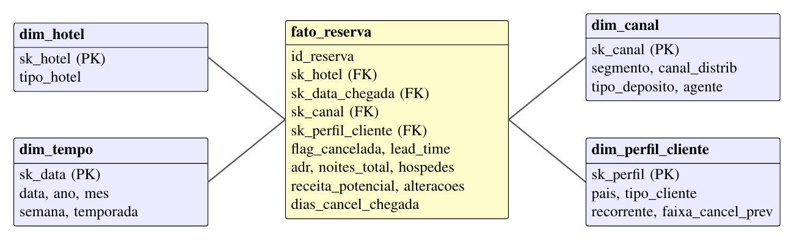

| Tabela | Linhas | Papel |
|---|---|---|
| `fato_reserva` | 119.208 | Medidas de cada reserva: cancelamento, antecedência, diária, noites, hóspedes, receita potencial |
| `dim_hotel` | 2 | Tipo do hotel |
| `dim_tempo` | 793 | Ano, mês, semana e temporada |
| `dim_canal` | 699 | Segmento, canal de distribuição, tipo de depósito e agente |
| `dim_perfil_cliente` | 496 | País, tipo de cliente, recorrência e faixa de cancelamentos anteriores |

📘 **O catálogo de dados completo**, com tipo, descrição, domínio (mínimos, máximos e categorias), obrigatoriedade e linhagem de cada atributo, está em [`catalogo/catalogo_dados.md`](catalogo/catalogo_dados.md).

---

## 5. Transformação e carga (ETL)

As regras de negócio aplicadas na passagem Bronze → Silver → Gold estão no notebook [`02_silver`](notebooks/02_silver.py). Como afetam diretamente a interpretação dos resultados, ficam explícitas aqui:

1. **Data de chegada:** composta a partir de ano, nome do mês (convertido para número) e dia.
2. **Nulos disfarçados:** os textos `"NULL"` de `agent`, `country` e `company` foram convertidos em nulos reais e rotulados como `sem_agente` e `desconhecido` nas dimensões.
3. **Crianças:** os 4 nulos de `children` foram preenchidos com zero.
4. **Rejeitados:** reservas sem hóspedes, com diária negativa ou com diária acima de 1.000 EUR foram removidas e gravadas em `silver.rejeitados`, com o motivo.
5. **Refeição:** as categorias `Undefined` e `SC` (sem refeição) foram unificadas, conforme a documentação original da base.
6. **Receita potencial:** calculada como `adr × noites_total`.
7. **Cancelamentos anteriores:** agrupados em faixas `0`, `1` e `2+`.
8. **Antecedência do cancelamento:** `dias_cancel_chegada` = data de chegada − `reservation_status_date`, que nas reservas canceladas registra a data do cancelamento.

**Linhas idênticas não foram removidas.** A base não tem identificador de reserva, e reservas de grupo legítimas podem coincidir em todos os atributos. Em vez de deduplicar, foi criado o identificador sequencial `id_reserva`. Essa é a decisão mais sensível do trabalho e é discutida na [Autoavaliação](#9-autoavaliação).

Todas as cargas usam modo `overwrite`, de forma que reexecutar o Job reproduz exatamente o mesmo estado das tabelas. O notebook Gold termina com uma verificação de integridade, que confirma que a fato tem o mesmo número de reservas da Silver (nenhuma perda nas junções):

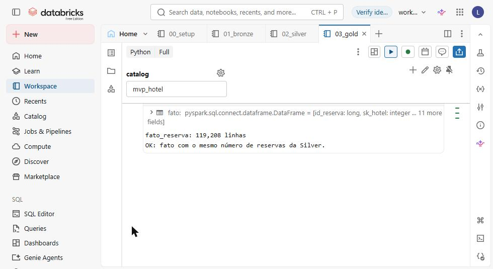

---

## 6. Qualidade dos dados

Cada atributo foi examinado nas dimensões de completude, unicidade, consistência, conformidade e acurácia (Batini e Scannapieco, 2006). Os atributos não listados abaixo apresentaram completude integral e valores dentro do domínio declarado.

| Dimensão | Atributo | Problema observado | Tratamento |
|---|---|---|---|
| Completude | `company` | 112.593 valores `"NULL"` (94,3%) | Atributo descartado |
| Completude | `agent` | 16.340 valores `"NULL"` (13,7%) | Rótulo `sem_agente` |
| Completude | `country` | 488 valores `"NULL"` (0,4%) | Rótulo `desconhecido` |
| Completude | `children` | 4 nulos | Preenchido com zero |
| Acurácia | `adults`, `children`, `babies` | 180 reservas com zero hóspedes | Rejeitadas |
| Acurácia | `adr` | 1 diária negativa e 1 acima de 1.000 EUR | Rejeitadas |
| Conformidade | `meal` | `Undefined` (1.169) e `SC` (10.650) representam a mesma categoria | Unificadas |
| Unicidade | todas | 31.994 linhas idênticas; sem chave natural | Mantidas; criado `id_reserva` |
| Consistência | `is_canceled` × `reservation_status` | Toda reserva cancelada tem status `Canceled` ou `No-Show` | Sem problema; `reservation_status` não usado como explicativo, por ser posterior ao desfecho |

**Resultado:** 182 registros (0,15%) foram rejeitados, e a Silver e a fato ficaram com **119.208 reservas**. Nenhum problema afeta de forma material as variáveis centrais da hipótese.

📸 Evidências da análise de qualidade

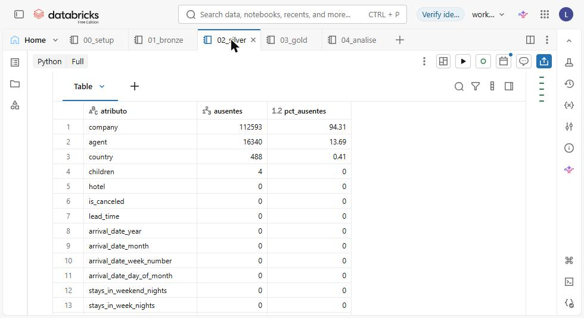
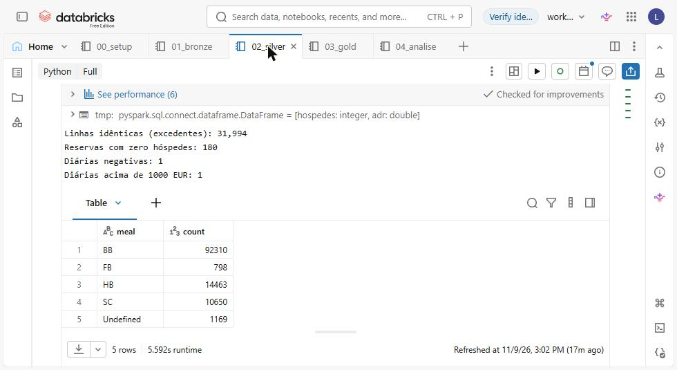
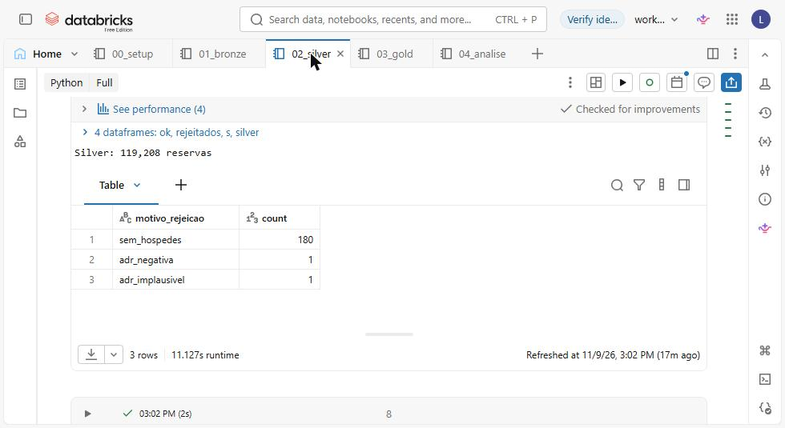

---

## 7. Resultados: perguntas de negócio

Todas as consultas estão no notebook [`04_analise`](notebooks/04_analise.py) e foram executadas sobre a camada Gold (119.208 reservas).

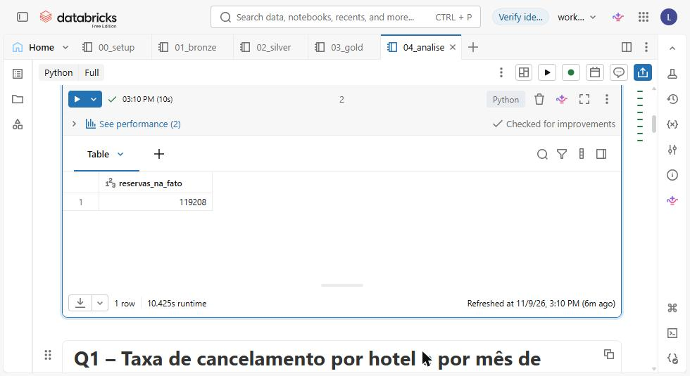

### Q1 — Taxa de cancelamento por hotel e por mês

| Hotel | Reservas | Taxa de cancelamento |
|---|---|---|
| City Hotel | 79.162 | **41,8%** |
| Resort Hotel | 40.046 | **27,8%** |

| Mês | City | Resort |
|---|---|---|
| Jan | 39,7% | 14,8% |
| Fev | 38,4% | 25,6% |
| Mar | 37,1% | 22,9% |
| Abr | 46,3% | 29,3% |
| Mai | 44,4% | 28,8% |
| Jun | 44,7% | 33,1% |
| Jul | 40,9% | 31,4% |
| Ago | 40,1% | 33,4% |
| Set | 42,1% | 32,4% |
| Out | 43,0% | 27,5% |
| Nov | 38,3% | 18,9% |
| Dez | 42,2% | 23,9% |

**Discussão.** Os dois hotéis se comportam de formas diferentes. No resort, a taxa acompanha a sazonalidade: vai de 14,8% em janeiro a 31–33% entre junho e setembro, quando a demanda é maior. No hotel urbano, a taxa é alta o ano todo, entre 37% e 46%, com pico de abril a junho. Uma margem única de *overbooking* para a rede subestimaria o risco do hotel urbano e superestimaria o do resort no inverno.

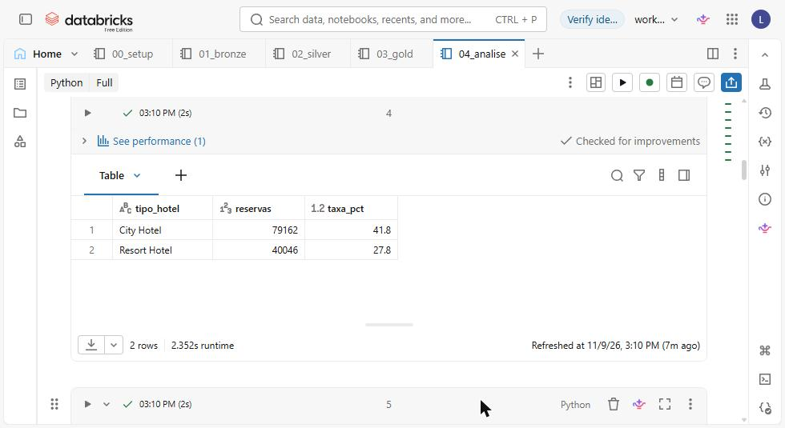

📸 Q1 por mês

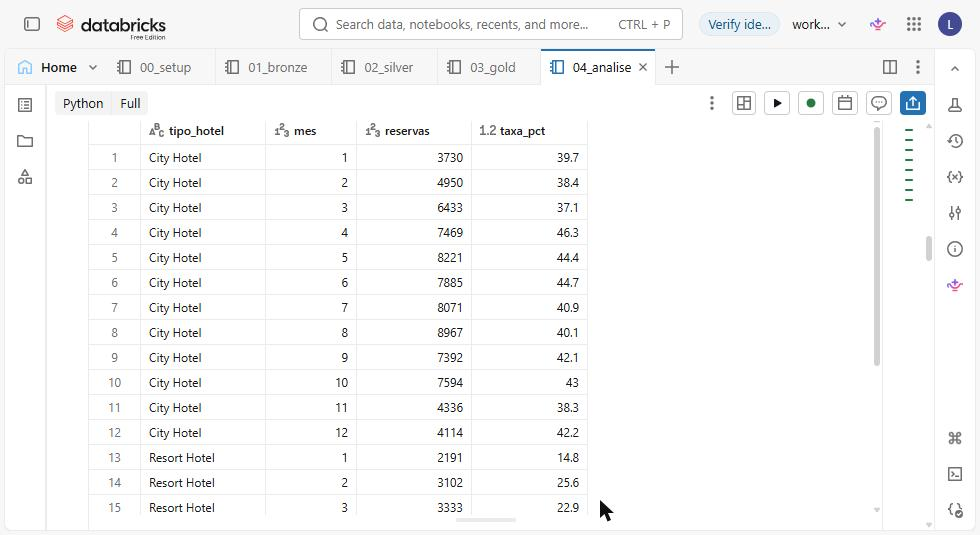
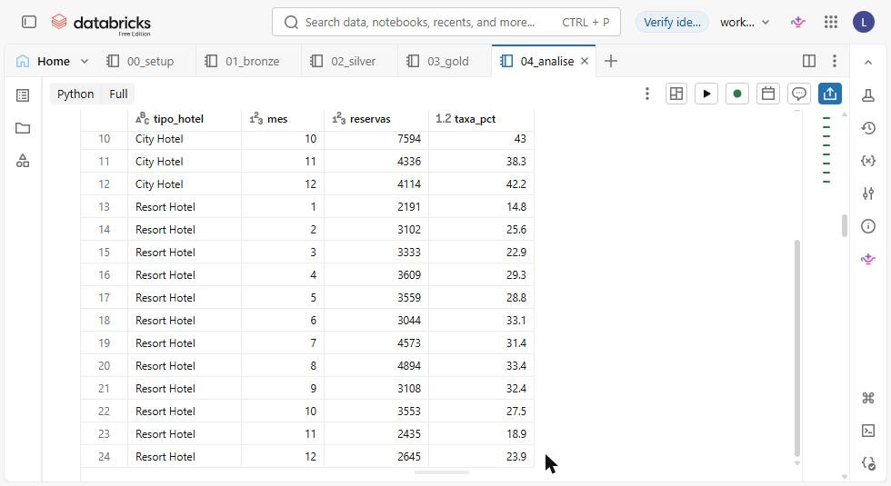

### Q2 — Antecedência da reserva

| Antecedência | Reservas | Canceladas | Taxa | Diária média (EUR) |
|---|---|---|---|---|
| 0 a 7 dias | 19.635 | 1.885 | **9,6%** | 90,5 |
| 8 a 30 dias | 18.945 | 5.283 | 27,9% | 108,2 |
| 31 a 90 dias | 29.528 | 11.140 | 37,7% | 106,4 |
| 91 a 180 dias | 26.420 | 11.819 | 44,7% | 109,2 |
| Acima de 180 dias | 24.680 | 14.071 | **57,0%** | 93,0 |

Teste qui-quadrado de independência: **χ² = 11.914,3; 4 graus de liberdade; p < 0,001.**

**Discussão.** A taxa de cancelamento cresce de forma consistente com a antecedência: reservas feitas com mais de seis meses cancelam seis vezes mais que as feitas na última semana. Quanto mais longe da data, mais tempo o cliente tem para mudar de planos ou encontrar tarifa melhor. A antecedência é, portanto, o critério mais simples para diferenciar margens de *overbooking*, e está disponível no momento da reserva.

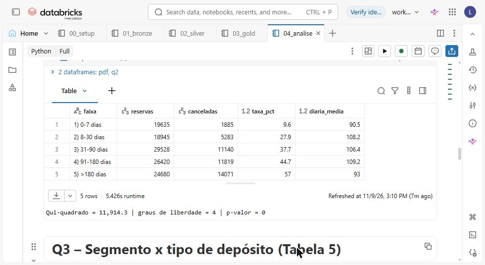

### Q3 — Segmento de mercado × tipo de depósito

| Segmento | Depósito | Reservas | Taxa | Antecedência média (dias) |
|---|---|---|---|---|
| Offline TA/TO | Non Refund | 5.005 | **99,9%** | 189 |
| Groups | Non Refund | 9.172 | **99,3%** | 232 |
| Corporate | Non Refund | 334 | 93,4% | 69 |
| Online TA | No Deposit | 56.334 | 36,7% | 83 |
| Groups | No Deposit | 10.488 | 28,3% | 148 |
| Aviation | No Deposit | 235 | 22,1% | 4 |
| Offline TA/TO | No Deposit | 19.172 | 17,2% | 121 |
| Direct | No Deposit | 12.557 | 15,3% | 50 |
| Corporate | No Deposit | 4.944 | 13,7% | 19 |
| Complementary | No Deposit | 728 | 12,2% | 14 |

Combinações com pelo menos 200 reservas.

**Discussão.** O resultado mais marcante contraria a intuição: reservas com depósito **não reembolsável** cancelam quase 100%, enquanto as sem depósito ficam entre 12% e 37%. Essas reservas são feitas com muita antecedência (189 a 232 dias), o que sugere bloqueios de quartos por operadoras e grupos, depois liberados, e não decisões de hóspedes individuais. Outra explicação possível é que o campo registre a política contratada, e não a cobrança efetiva. Em qualquer caso, **o achado precisa ser validado com o hotel antes de fundamentar uma decisão**. Entre as reservas sem depósito, o maior risco está no segmento *Online TA* (36,7%), que também é o de maior volume.

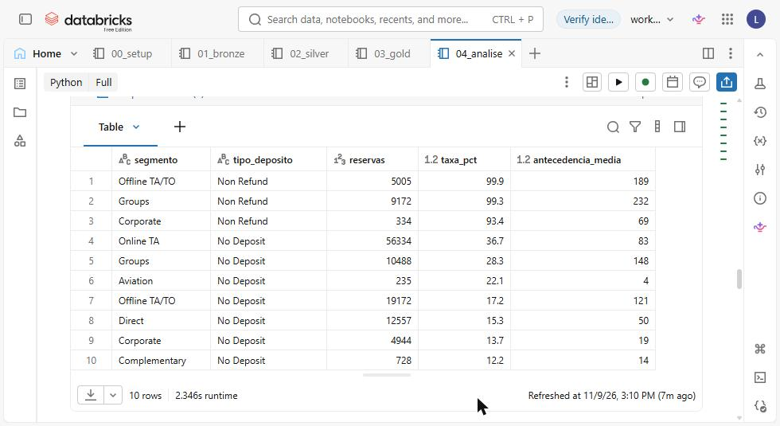

### Q4 — Receita potencial cancelada

| Hotel | Receita cancelada (milhões de EUR) | % cancelada a menos de 7 dias da chegada |
|---|---|---|
| City Hotel | 10,88 | 12,4% |
| Resort Hotel | 5,84 | 7,3% |
| **Total** | **16,72** | **10,7%** |

**Discussão.** As reservas canceladas representam 16,72 milhões de euros em receita potencial no período, 65% no hotel urbano. No resort, a perda se concentra no verão: só julho e agosto de 2017 somam 1,52 milhão de euros. Cerca de 10,7% desse valor foi cancelado na última semana antes da chegada, quando a chance de revender o quarto é baixa. Como a base não informa se o quarto foi revendido, esse valor é um **limite superior** da perda efetiva.

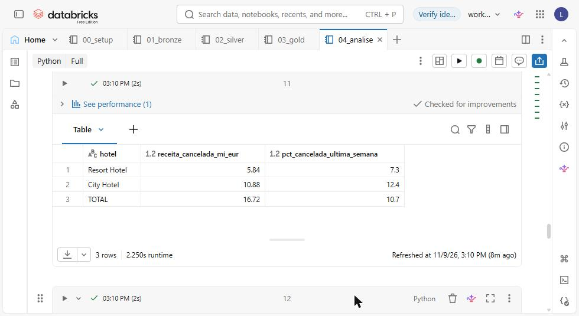

📸 Q4 receita mensal (26 meses × 2 hotéis)

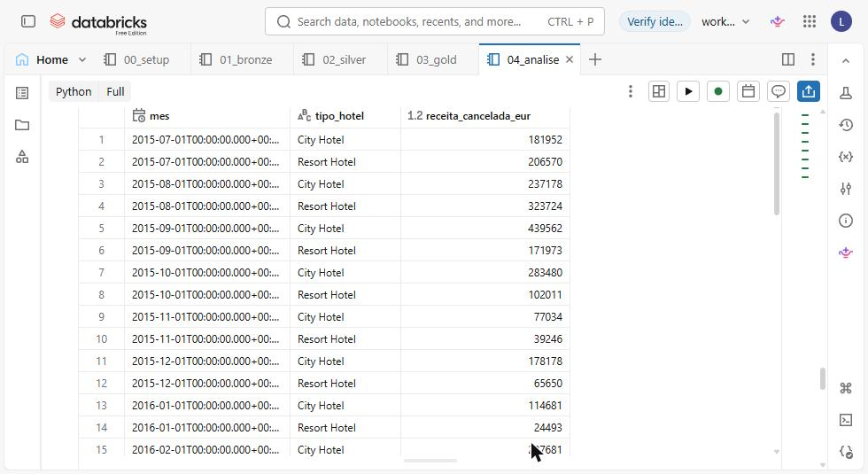
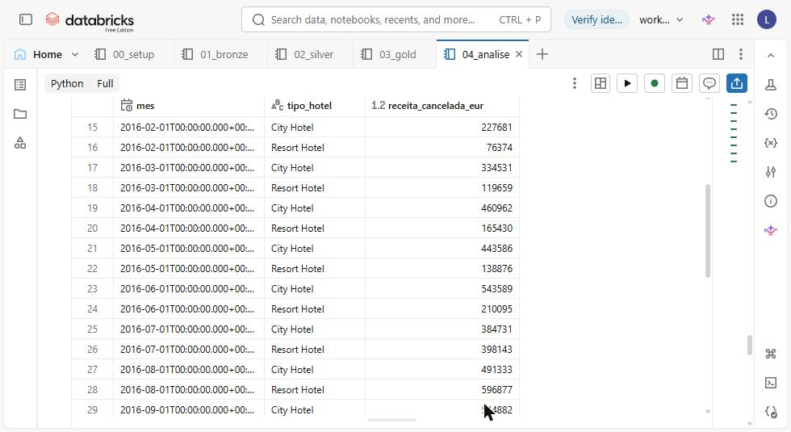
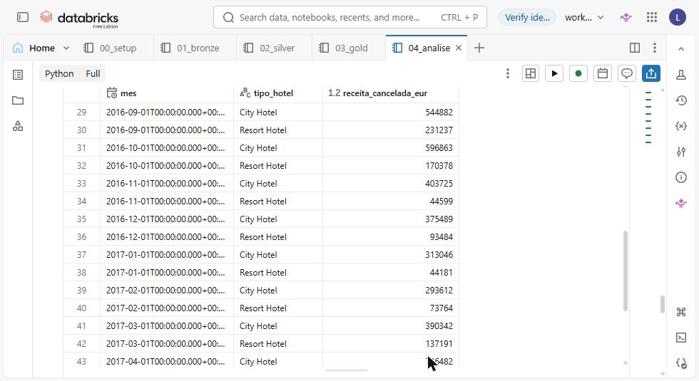
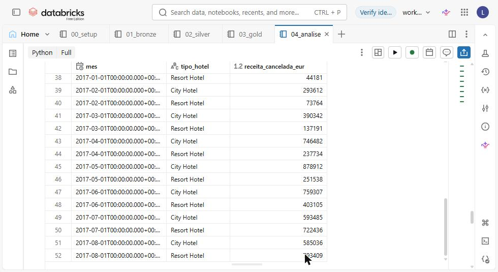

### Q5 — Histórico do cliente

| Cliente recorrente | Reservas | % da base | Taxa |
|---|---|---|---|
| Sim | 3.754 | 3,1% | **14,7%** |
| Não | 115.454 | 96,9% | **37,8%** |

| Cancelamentos anteriores | Reservas | Taxa |
|---|---|---|
| 0 | 112.729 | 33,9% |
| 1 | 6.048 | **94,4%** |
| 2 ou mais | 431 | 52,9% |

**Discussão.** Clientes recorrentes cancelam bem menos (14,7% contra 37,8%). Já o histórico de cancelamentos tem um padrão curioso: quem cancelou exatamente uma vez antes cancela 94,4%, mas quem cancelou duas ou mais vezes cancela 52,9%. Como a relação não é crescente, é provável que parte desses registros também corresponda a reservas de grupos e operadoras, e não a hóspedes individuais. O histórico é um sinal útil, mas cobre uma parcela pequena da base (só 3,1% de recorrentes).

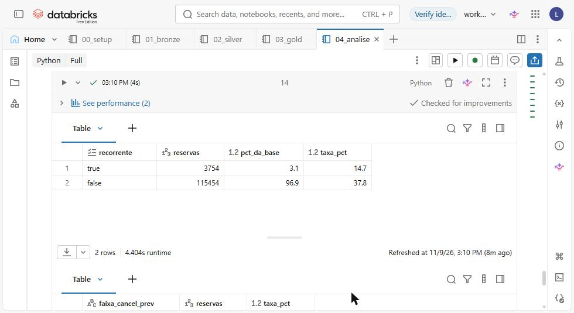
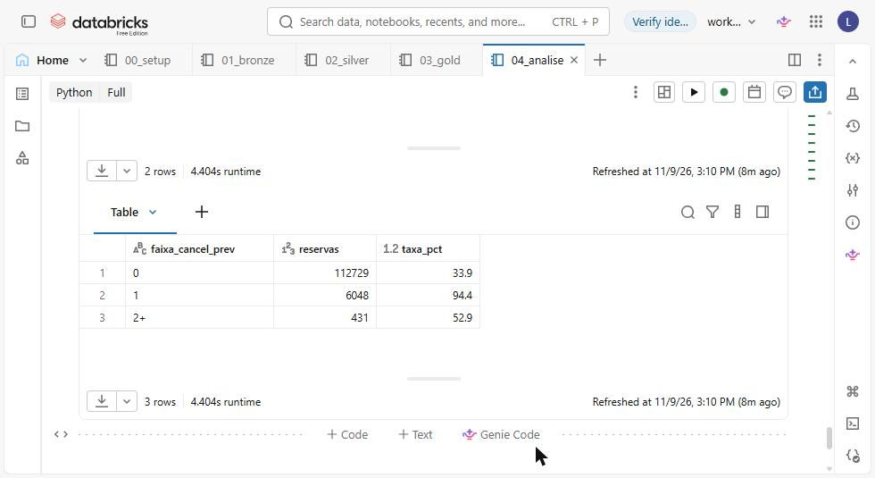

---

## 8. Discussão geral

As respostas sustentam a hipótese do MVP: o cancelamento **não se distribui ao acaso**. Ele varia de forma sistemática com o hotel (Q1), a antecedência (Q2), o segmento e o depósito (Q3) e o histórico do cliente (Q5), e representa uma perda potencial relevante (Q4).

**Decisão sugerida ao gestor:** substituir a margem uniforme de *overbooking* por margens específicas para cada combinação de hotel, temporada e faixa de antecedência, iguais à taxa histórica de cancelamento de cada célula. Além disso, investigar com a equipe comercial as reservas não reembolsáveis de operadoras e grupos, que concentram cancelamentos quase totais.

| Dimensão do MVP | Evidência |
|---|---|
| **Viabilidade técnica** | Pipeline executado ponta a ponta no Databricks, com Job automatizado e dados persistidos em tabelas Delta |
| **Viabilidade financeira** | Todo o volume processado no nível gratuito, em 1 min 33 s; em uso contínuo, o custo seria o de um cluster pequeno agendado diariamente |
| **Desejabilidade** | As respostas apontam decisões concretas de *overbooking* e depósito, ligadas a uma perda potencial de 16,7 milhões de euros |

**Cautela:** as associações observadas são descritivas, não causais, e dois hotéis portugueses não representam o mercado hoteleiro em geral.

---

## 9. Autoavaliação

**Quais perguntas foram respondidas?**
Q1, Q2, Q3 e Q5 foram respondidas integralmente. A Q4 foi respondida em parte: foi possível medir a receita potencial cancelada e a parcela cancelada na última semana, mas a base não indica se os quartos foram revendidos, o que impede medir a perda efetiva.

**Que limitações dos dados condicionaram os resultados?**
O período é curto (2015–2017) e restrito a dois hotéis de um único país. A base não tem identificador de reserva, o que impede distinguir duplicatas de reservas de grupo. Também não há informação sobre revenda dos quartos nem sobre a cobrança efetiva dos depósitos, o que limita a interpretação de Q3 e Q4.

**O que eu faria de forma diferente se recomeçasse?**
Investigaria com mais cuidado as 31.994 linhas idênticas, rodando as análises com e sem deduplicação para medir o efeito nas taxas. Também incluiria desde o início uma dimensão de data de cancelamento, em vez de apenas a medida `dias_cancel_chegada`.

**O que seria preciso para transformar o MVP em uma solução de uso contínuo?**
Ingestão incremental integrada ao sistema de reservas do hotel; testes automatizados de qualidade a cada carga; um modelo preditivo que estime a probabilidade de cancelamento de cada reserva no momento em que ela é feita; e um painel publicado para a equipe de gestão de receitas.

---

## 10. Como reproduzir

1. Crie uma conta na **Databricks Free Edition**.
2. Importe os 5 notebooks da pasta [`/notebooks`](notebooks/) no seu Workspace (Workspace → ⋮ → Import).
3. Rode o [`00_setup`](notebooks/00_setup.py). Ele cria o catálogo `mvp_hotel`, os esquemas `bronze`, `silver` e `gold` e o volume `raw`.
4. Baixe o `hotel_bookings.csv` no [Kaggle](https://www.kaggle.com/datasets/jessemostipak/hotel-booking-demand) e envie para `Catalog → mvp_hotel → bronze → raw → Upload to this volume`.
5. Rode `01_bronze`, `02_silver` e `03_gold`, em ordem, ou crie um Job com essas três tarefas encadeadas.
6. Rode `04_analise` para obter os resultados de Q1 a Q5.

> Se a criação do catálogo `mvp_hotel` não for permitida, o `00_setup` usa o catálogo `workspace`. Nesse caso, altere o campo `catalog` no topo de cada notebook.

---

## 11. Estrutura do repositório

| Caminho | Conteúdo |
|---|---|
| `README.md` | Este documento |
| [`/notebooks`](notebooks/) | Notebooks de setup, Bronze, Silver, Gold e análise (formato de origem do Databricks) |
| [`/catalogo`](catalogo/) | Catálogo de dados, diagrama do esquema estrela e diagrama da arquitetura |
| [`/evidencias`](evidencias/) | Capturas de tela da execução no Databricks |
| [`/paper`](paper/) | Short paper em LaTeX (Overleaf) |
| `LICENSE` | Licença MIT do código e registro da licença CC BY 4.0 dos dados |

---

## 12. Referências

- ANTONIO, N.; ALMEIDA, A.; NUNES, L. Hotel booking demand datasets. **Data in Brief**, v. 22, p. 41–49, 2019.
- ANTONIO, N.; ALMEIDA, A.; NUNES, L. Predicting hotel booking cancellations to decrease uncertainty and increase revenue. **Tourism & Management Studies**, v. 13, n. 2, p. 25–39, 2017.
- ARMBRUST, M. et al. Delta Lake: high-performance ACID table storage over cloud object stores. **Proceedings of the VLDB Endowment**, v. 13, n. 12, p. 3411–3424, 2020.
- BATINI, C.; SCANNAPIECO, M. **Data quality**: concepts, methodologies and techniques. Berlin: Springer, 2006.
- KIMBALL, R.; ROSS, M. **The data warehouse toolkit**: the definitive guide to dimensional modeling. 3. ed. Indianapolis: Wiley, 2013.
- KIMES, S. E. Yield management: a tool for capacity-constrained service firms. **Journal of Operations Management**, v. 8, n. 4, p. 348–363, 1989.
- MOSTIPAK, J. **Hotel booking demand**. Kaggle, 2020. Disponível em: https://www.kaggle.com/datasets/jessemostipak/hotel-booking-demand. Acesso em: 9 nov. 2026.
- TALLURI, K. T.; VAN RYZIN, G. J. **The theory and practice of revenue management**. New York: Springer, 2004.
